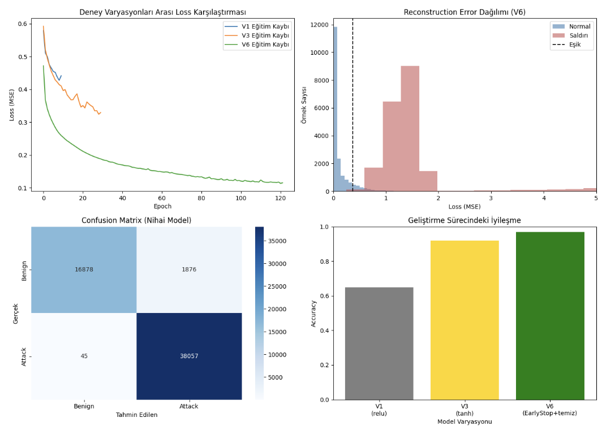
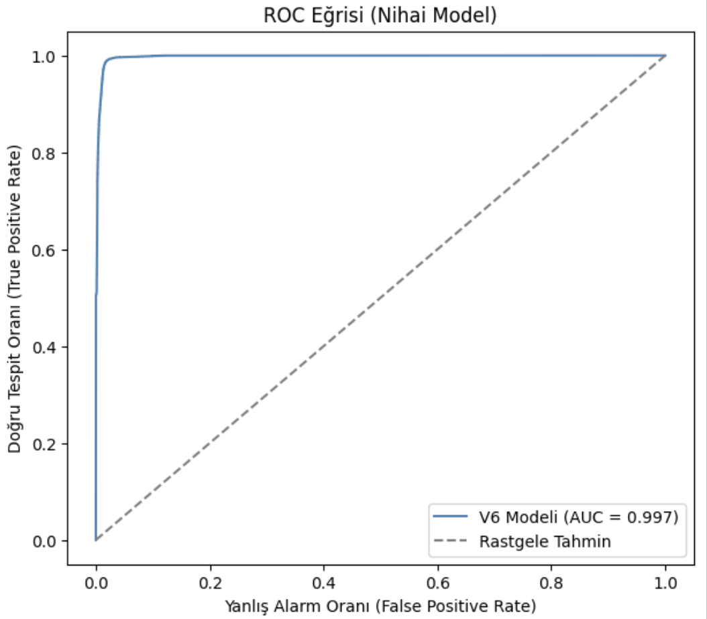
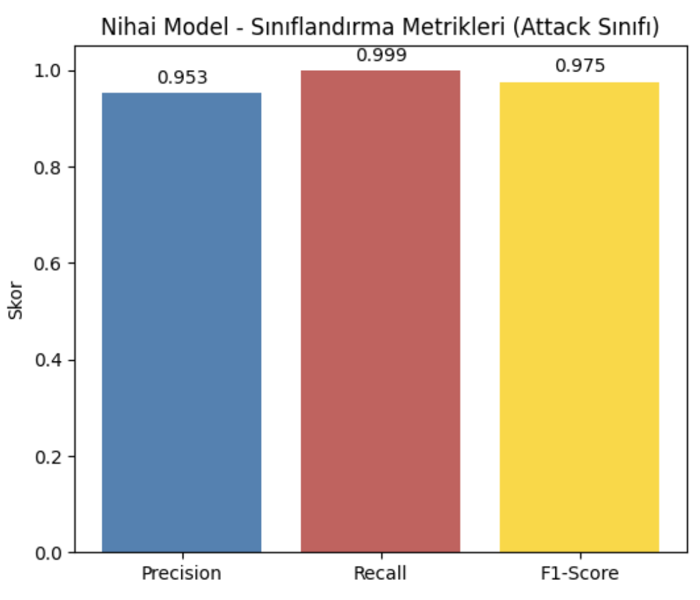

# Behavioral Anomaly Detection in EDR/XDR Systems using LSTM Autoencoder

Bu proje, modern **EDR/XDR (Endpoint/Extended Detection and Response)** sistemlerinin temel çalışma mekanizmalarından biri olan denetimsiz (unsupervised) ve davranışsal anomali tespiti mantığını simüle eden bir derin öğrenme çalışmasıdır.

Model, **yalnızca benign (normal) ağ trafiği dizileri** kullanılarak eğitilmiş; **FTP-BruteForce** ve **SSH-Bruteforce** saldırı trafikleri ise modele daha önce hiç gösterilmeden test aşamasında anomali olarak değerlendirilmiştir.

---

## 📌 Proje Özeti ve Temel Yaklaşım

* **Etiketsiz / Davranışsal Öğrenme:** Model saldırı imzalarına veya etiketlere bağımlı değildir. Normal davranışı öğrenip, yeniden inşa hatası (reconstruction error) yüksek olan örüntüleri anomali olarak işaretler.
* **Olay Zinciri (Sequence / Event-Chaining):** Ağ akışlarına (flow) bağımsız bakmak yerine, aynı hedef porta (`Dst Port`) kısa zaman aralığında gelen ardışık **10 flow'luk diziler** oluşturulmuştur.
* **Kritik Çıkarım (Güvenlik Önceliği):** Siber güvenlikte saldırıyı kaçırmama (False Negative azaltma) önceliğiyle eşik değeri %90 persentil olarak seçilmiş, **%100 Attack Recall (45/38.102 kaçırma)** ve **%97 genel doğruluk** elde edilmiştir.

---

## 📊 Veri Seti, Ön İşleme ve Outlier Mühendisliği

* **Veri Kaynağı:** CICIDS2018 (`Wednesday-14-02-2018_TrafficForML_CICFlowMeter.csv`)
* **Sınıf Dağılımı:**
  * Toplam Temiz Satır: `1.044.746`
  * Benign (Normal): `663.803` (~%64)
  * FTP-BruteForce: `193.354` (~%18)
  * SSH-Bruteforce: `187.589` (~%18)
* **Dizi Oluşturma (Sliding Window):** Toplam `100.615` dizi (Shape: `10 × 77`)
* **Outlier (Aykırı Değer) Mühendisliği:** Sıfıra yakın süreye bölme kaynaklı sütunlardaki (`Flow Byts/s`, `TotLen Fwd Pkts` vb.) aşırı uç değerler, matematiksel patlamaları önlemek amacıyla tüm sayısal sütunlara **%99 persentil kırpma (clipping)** uygulanarak dengelenmiş ve model stabilizasyonu sağlanmıştır.

---

## 🧠 Model Mimarisi

* **Model Türü:** LSTM Autoencoder
* **Eğitim Optimizasyonu:** Optimizer: `Adam`, Loss: `MSE`, Callback: `EarlyStopping` (122. epoch'ta doğal durma sağlandı).

---

## 📈 İterasyonlar ve Gelişim Süreci

Proje geliştirme sürecinde adım adım kaydedilen performans ve stabilizasyon aşamaları:

| Aşama | Değişiklik / Karar | Sonuç |
|---|---|---|
| **V1 (relu)** | Kirli veri, ham başlangıç | Dalgalı `val_loss`, Recall: %51, Accuracy: %65 |
| **V3 (tanh)** | Aktivasyon Değişimi | `val_loss` stabilize oldu, hata farkı 7.16 katına çıktı |
| **V6 (Nihai)** | Outlier temizliği + EarlyStop | Hata farkı **41.5 katına** çıktı, F1-Score %99'a ulaştı |

 

  

 

---

## 🎯 Performans & Değerlendirme

SOC/EDR operasyonlarında saldırıyı kaçırmanın (False Negative) maliyeti yanlış alarmlardan (False Positive) çok daha kritik olduğu için **%90 persentil eşiği (0.375)** tercih edilmiştir.

* **Attack Recall:** `%100` (38.102 saldırı dizisinden 38.057'si yakalandı)
* **Attack Precision:** `%95`
* **Benign Recall:** `%90` (Yanlış Alarm Oranı: %10)
* **Genel Doğruluk (Accuracy):** `%97`

 

  
  

